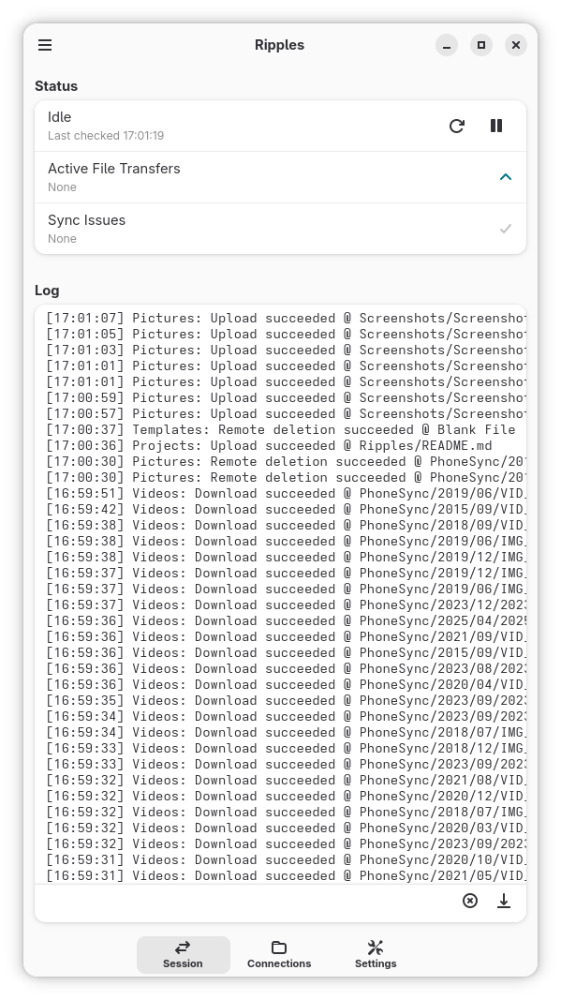
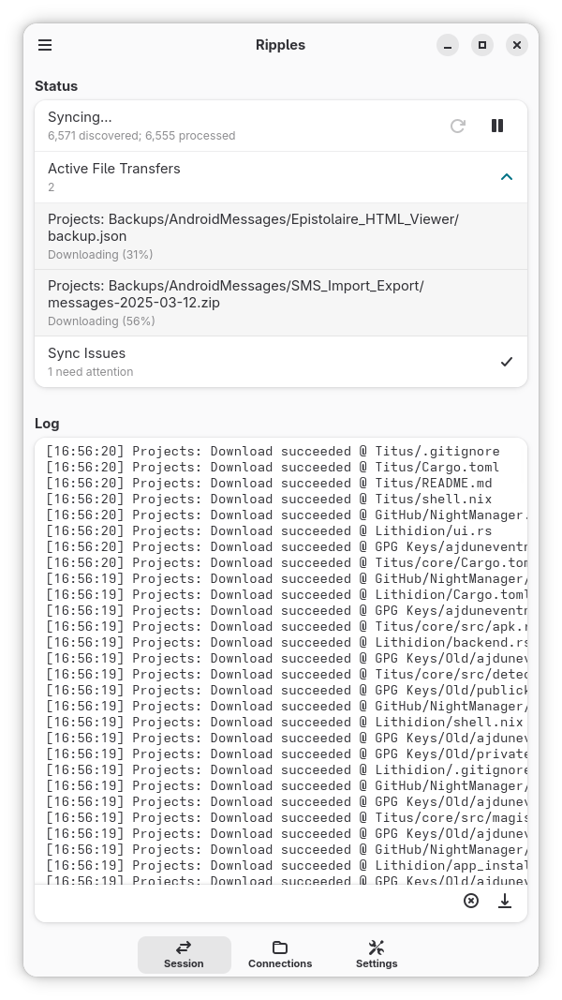
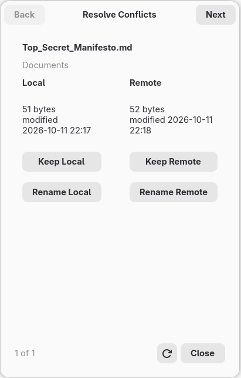
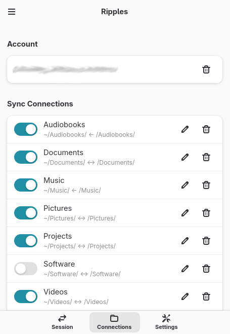
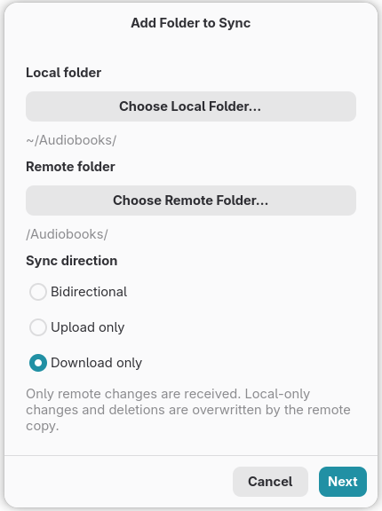
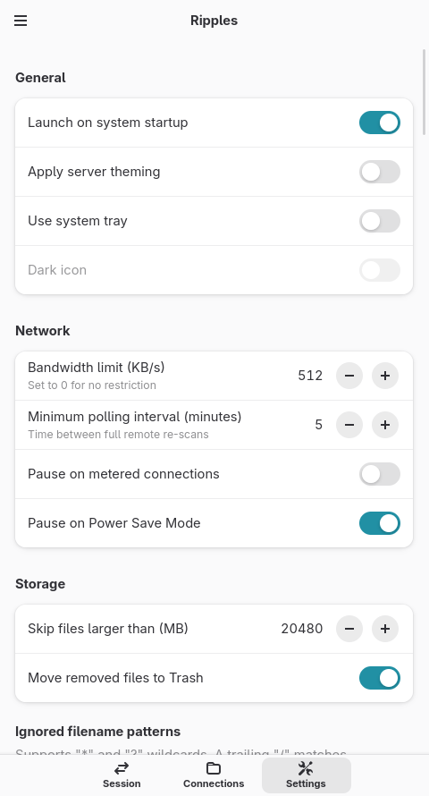
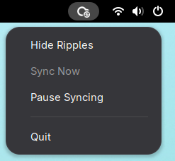

<p align="center">
  
</p>

# Ripples

An adaptive Nextcloud sync client built for GNOME Shell and Phosh using Rust and libadwaita

## Screenshots

<p align="center">
  
  
  
  
  
  
</p>

## Features

### Account Options

- Direct login via Nextcloud's Login Flow v2
- Alternatively, select account from GNOME Online Accounts (including limited, experimental support for ownCloud and generic WebDAV servers)

### Sync Connections

- Configure multiple local-folder to remote-folder pairs per account
- Connections can be bidirectional, upload only, or download only
- Enable/disable switch per connection

### Change detection

- Local changes detected through inotify (GFileMonitor)
- Nextcloud notify_push used for instant remote change notification when the server supports it
- A cheap root-ETag check skips full crawls when nothing changed on the server where supported (Nextcloud and ownCloud)
- Polling and full crawls as fallback and for WebDAV

### Correctness

- Files that look changed on both sides are compared by content hash (XXH3)
- Large files hashed in parallel 128 MiB chunks using HTTP range requests
- Local renames and moves detected by inode and replayed as a remote move instead of a delete and re-upload
- Transfers are atomic: Downloads write a temporary file then rename it, and uploads write a temporary remote object then WebDAV MOVE it into place
- Large uploads use the Nextcloud chunking API when the server supports it
- File modifications are gated by a settle time to avoid uploading a half-written file
- Executable bits survive a re-download

### Conflicts

- Resolution options: Keep Local, Keep Remote, Keep Both (rename local), Keep Both (rename remote)
- Resolution dialog shows live local and remote details
- Conflicting items are re-checked every round, so further changes on either side are noticed

### Exclusions

- Global glob patterns (`*.tmp`, `node_modules`) with a built-in default list
- Per-connection excluded folders
- Honors `.no-sync` file per directory
- Maximum file size limit

### Power and network

- Optional automatic pausing of transfers on metered connections
- Optional automatic pausing of transfers in system power-saver mode
- Less frequent polling while on battery

### Desktop integration

- Optional System tray icon (SNI)
- Optional launch at login, started hidden with `--hidden`
- Runs in background unless quit from menu or Ctrl+Q

<p>
  
</p>

## Building

Requirements:

- Rust toolchain (2021 edition)
- GTK 4.18 or later and libadwaita 1.5 or later, with development headers
- `pkg-config` and a C compiler such as `gcc`

```
git clone https://dev.dunevent.net/aj/Ripples.git && cd Ripples
cargo build --release
```

Developed against GTK 4.22 and libadwaita 1.9.

## Command-line flags

| Flag | Effect |
| --- | --- |
| `--hidden` | Start without showing the window (used by autostart) |
| `--debug` | Enable verbose `[debug]` logging for this run |

## Files

| Path | Contents |
| --- | --- |
| `~/.config/ripples/config.json` | Accounts, connections, and settings |
| `~/.config/ripples/custom-exclude-patterns.json` | Custom exclusion patterns |
| `~/.local/share/ripples/journal.sqlite3` | Sync journal (last-synced state for every item) |
| `~/.local/share/ripples/logs/` | Session logs |

## Limitations

- Only one active account is allowed at a time
- Interrupted transfers restart from the beginning
- POSIX permissions other than the executable bit are not synced
- Excluded-folder rules are exact paths and do not follow a rename
- Sync Connections cannot nest or overlap
- Symlinks are ignored

## Roadmap

- Resumable uploads and downloads
- Exclusion rules that follow renames

## AI Disclaimer

This project has relied extensively on AI-assisted development, primarily Anthropic's Claude (various models), under human direction and manual testing.

### Contribution Profile

```
Phase                    Human █                  ░ AI
───────────────────────────────────────────────────────
Requirements & Scope      100% ████████████████████  0%
Architecture & Design      75% ███████████████░░░░░ 25%
Implementation              5% █░░░░░░░░░░░░░░░░░░░ 95%
Testing                    90% ██████████████████░░ 10%
Documentation              35% ███████░░░░░░░░░░░░░ 65%
```
***Humorous aside:***  
These were not the original approximations but Claude expressed that some were "**generous** to the human side," adding "*and I can back that up from the repository.*"  Girl came with RECEIPTS, lol.

## License

GPL-3.0-or-later. See [LICENSE](LICENSE). The bundled tray icons are from the [MoreWaita](https://github.com/somepaulo/MoreWaita) icon theme (GPL-3.0).
